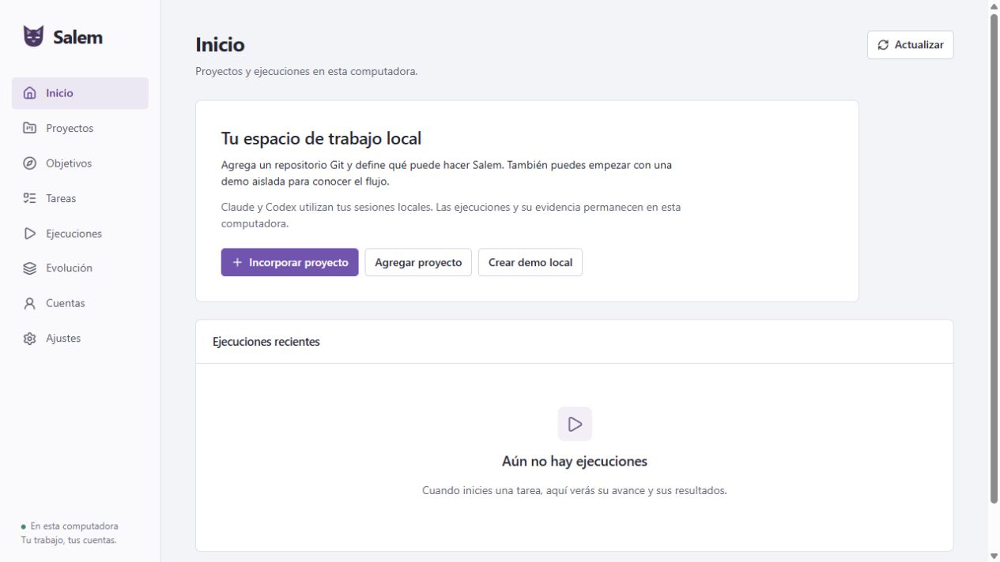
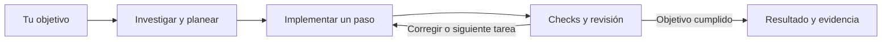

<p align="center">
  
</p>

<h1 align="center">Salem</h1>

<p align="center"><strong>De un objetivo a cambios comprobados, con Claude y Codex.</strong></p>

<p align="center">
  <a href="https://github.com/88randy/Salem/actions/workflows/ci.yml"></a>
  <a href="https://github.com/88randy/Salem/releases"></a>
  <a href="LICENSE"></a>
  
</p>

<p align="center">
  <a href="#empezar">Empezar</a> ·
  <a href="#cómo-funciona">Cómo funciona</a> ·
  <a href="#qué-aporta-a-tu-trabajo">Qué aporta</a> ·
  <a href="#documentación">Documentación</a> ·
  <a href="#contribuir">Contribuir</a>
</p>

Salem es una aplicación local de **gestión de proyectos de software con agentes de IA**. Le explicas qué quieres conseguir y mantiene el hilo del trabajo: investiga el repositorio, aclara lo que falta, prepara tareas dependientes y coordina implementación, pruebas y revisión.

Puedes trabajar con Claude, con Codex o con ambos. Salem utiliza los CLIs oficiales y las cuentas que conectes en tu computadora. Tú eliges los modelos y delegas los permisos; el controlador conserva el estado y comprueba la aceptación de cada resultado.



*Demo local con Codex: tres pasos aceptados y objetivo completado en una copia aislada. Las funciones incluidas en cada descarga se detallan en sus notas de versión.*

> [!NOTE]
> **Beta local para Windows x64.** Este README describe la rama actual. Revisa [Releases](https://github.com/88randy/Salem/releases) para conocer las funciones y validaciones del instalador que descargues, y los [PR abiertos](https://github.com/88randy/Salem/pulls) para seguir el trabajo aún en desarrollo.

[Novedades y compatibilidad de la versión conversacional 0.5 →](docs/RELEASE-0.5.0.md)

## Qué aporta a tu trabajo

Un cambio suele exigir entender el código, decidir por dónde empezar, repartir tareas, revisar resultados y retomar lo pendiente. Salem conserva esa gestión en una conversación con su plan y sus evidencias.

| Lo que necesitas | Cómo te ayuda Salem |
| --- | --- |
| Pasar de una idea a un plan ejecutable | Investiga el proyecto, identifica dependencias y divide el objetivo en tareas con criterios de aceptación. |
| Avanzar con pocas instrucciones | Toma decisiones técnicas dentro del perfil del proyecto. Cuando falta una decisión de producto que no puede deducir, te pregunta en el chat. |
| Aprovechar tus agentes | Asigna implementaciones a los agentes permitidos y conserva los roles de definición y revisión que configuraste. |
| Saber si el cambio funciona | Ejecuta los checks del proyecto y exige revisión en otra sesión. La última tarea comprueba también el resultado conjunto. |
| Retomar sin perder el contexto | Guarda mensajes, planes, intentos, resultados y checkpoints. Conserva el trabajo aceptado cuando un paso falla. |
| Entender qué pasó | Te muestra avances y permite abrir el diff, los checks, los logs y el uso reportado por cada ejecución. |

El beneficio es dedicar menos atención a trasladar contexto y coordinar cada paso. El tiempo y las iteraciones se pueden medir; Salem no presenta estimaciones de ahorro como resultados demostrados.

## Cómo funciona

Escribe, por ejemplo:

> «Completa el carrito: calcula el subtotal, aplica la política de envío y comprueba el total. Conserva la API y los verificadores existentes.»

Salem investiga primero. Si falta la política de envío, te pregunta; con tu respuesta prepara el plan y trabaja paso a paso. Puedes precisar el objetivo, adjuntar referencias de texto, detener el trabajo o revisar sus resultados desde el mismo chat.



**Salem orquesta; los modelos investigan, implementan y revisan.** El plan puede asignar cada implementación a un agente permitido por el perfil. Los proveedores, modelos, esfuerzos, roles y límites se configuran por proyecto. Una revisión debe realizarse en una sesión independiente de la implementación, aunque utilices un solo proveedor.

Cada paso parte del último código aceptado, en una copia Git independiente. Un intento fallido conserva su evidencia y la base anterior. Si cambias las instrucciones, Salem detiene el trabajo en curso antes de preparar otra revisión del plan. Si el proveedor rechaza un modelo o agota su cuota, el flujo se detiene y lo informa; no cambia silenciosamente tu elección.

La conversación entrega el resultado **localmente**. Publicar, integrar o desplegar se realiza mediante un flujo explícito de entrega y sus permisos delegados. [Leer la guía del chat →](docs/CONVERSATIONS.md)

## Empezar

### Aplicación para Windows

1. Descarga el instalador de [Releases](https://github.com/88randy/Salem/releases). Incluye Node.js; necesitas Git y los CLIs oficiales de [Claude Code](https://code.claude.com/docs/en/setup) o [Codex](https://developers.openai.com/codex/cli).
2. Abre Salem y entra a **Cuentas** para comprobar o conectar los proveedores que vayas a utilizar.
3. En **Proyectos**, incorpora una carpeta Git y revisa las comprobaciones detectadas, los agentes y los permisos.
4. Ve a **Inicio**, elige el proyecto y describe lo que quieres lograr.

Cada persona utiliza su propia computadora y sus propias cuentas. Si tus CLIs ya trabajan con una sesión de tu cuenta, Salem puede utilizarla sin pedirte otra API key. Las llamadas a modelos consumen la cuota o los créditos de esa cuenta.

[Instalación, actualización y desinstalación →](docs/WINDOWS.md)

### Desde el código fuente

Requiere **Node.js 22**, npm y Git:

```sh
git clone https://github.com/88randy/Salem.git
cd Salem
npm ci
npm run salem
```

Abre la dirección que imprime la terminal, normalmente `http://127.0.0.1:3210`. La interfaz se abre en tu navegador y el servidor escucha en tu equipo.

## Qué puedes pedirle

| Ejemplo de objetivo | Qué hace el flujo |
| --- | --- |
| «Investiga por qué falla este cálculo y corrígelo conservando la API.» | Investiga la causa, prepara el trabajo y comprueba la corrección. |
| «Agrega esta validación y cubre los casos límite con los checks del proyecto.» | Organiza los pasos, implementa y exige aceptación verificable. |
| «Explícame cómo funciona este módulo antes de cambiarlo.» | Puede responder tras investigar, sin iniciar una implementación. |
| «Continúa con este ajuste y conserva lo que ya está aceptado.» | Replantea lo pendiente sobre el último resultado aceptado. |

El contexto y las comprobaciones del repositorio importan. Salem puede detectar tecnologías, instrucciones y checks al incorporarlo; los verificadores nuevos propuestos por un agente requieren revisar explícitamente el perfil. La conversación no altera sus propias reglas de aceptación para conseguir un resultado verde.

## También incluye

- **Espacio de trabajo:** proyectos, conversaciones, búsqueda, recientes y actividad. Las herramientas avanzadas conservan acceso a tareas, investigaciones y ejecuciones individuales.
- **Perfiles de proyecto:** agentes, modelos, preparación del entorno, checks, capacidades y presupuestos de tiempo, intentos y uso.
- **Recuperación:** estado durable, pausas, cancelación de procesos propios y continuación desde checkpoints verificables.
- **Entrega delegada:** commits, PR, integración y despliegue cuando configuras y autorizas esas capacidades.
- **Evolución con pruebas:** propone y evalúa mejoras con la aceptación existente; puede aplicar una candidata validada con respaldo y reversión.
- **Métricas:** tiempos, iteraciones y uso informado por los proveedores. Los valores no reportados permanecen desconocidos.

## Tus datos, permisos y límites

Los proyectos y evidencias permanecen en tu equipo. Las credenciales siguen en el almacenamiento oficial de cada CLI; las consultas a modelos envían contexto al proveedor correspondiente. El servidor escucha únicamente en `127.0.0.1`.

Editar, crear commits, publicar, integrar y desplegar son capacidades separadas. Registrar un proyecto no las habilita todas. La autoevolución tampoco puede cambiar verificadores, instrucciones, permisos o reglas de aceptación.

La beta tiene límites concretos:

- Se verifica en **Windows x64**. No se acredita compatibilidad con otros sistemas, navegadores o dispositivos por pasar una demo local.
- El coordinador ejecuta **una tarea a la vez por conversación**. Las referencias adjuntas del chat son archivos de texto UTF-8.
- El instalador aún **no tiene firma digital**. Las descargas incluyen hashes de integridad.
- Los agentes y checks corren con tu usuario. Una copia Git y los límites de herramientas no constituyen una sandbox del sistema operativo.

Consulta [seguridad](SECURITY.md) y las [notas de versión](https://github.com/88randy/Salem/releases) antes de decidir qué trabajo delegar.

## Documentación

| Guía | Para qué sirve |
| --- | --- |
| [Gestión conversacional](docs/CONVERSATIONS.md) | Objetivos, preguntas, tareas, continuidad y resultados del chat. |
| [Windows](docs/WINDOWS.md) | Instalar, actualizar, operar y conservar los datos. |
| [Modelos y colaboración](docs/MODELS.md) | Configurar proveedores, modelos, esfuerzos y roles. |
| [Checks y aceptación](docs/CHECKS.md) | Entender qué permite aceptar o detener un cambio. |
| [Supervisor y recuperación](docs/SUPERVISOR.md) | Checkpoints, interrupciones y continuación. |
| [Entrega y capacidades](docs/DELIVERY.md) | Delegar commits, PR, integración o despliegue. |
| [Métricas](docs/METRICS.md) | Interpretar mediciones y sus límites. |
| [Citar Salem](docs/CITATION.md) | Autoría, ORCID y referencia de la versión utilizada. |
| [Guía completa](docs/SALEM.md) | Consultar el funcionamiento general del framework. |

## Citar Salem

Si utilizas Salem en un trabajo, cita la versión que hayas usado:

> Randy Allan. (2026). *Salem* (versión 0.5.1) [Software]. Zenodo.
> [https://doi.org/10.5281/zenodo.23679216](https://doi.org/10.5281/zenodo.23679216)

Los metadatos están en [CITATION.cff](CITATION.cff), con el
[ORCID de Randy Allan](https://orcid.org/0009-0004-9018-8138). Consulta la
[guía de citación y archivo](docs/CITATION.md) para los datos de la versión
archivada y la publicación de próximas versiones.

## Desarrollo

```sh
npm ci
npm run typecheck
npm test
npx playwright install chromium
npm run test:ui
npm run test:distribution
```

Las pruebas automatizadas usan procesos de fixtures y no consumen cuota de IA. Las pruebas con cuentas reales se ejecutan por separado y se identifican como tales. Para usar Chrome instalado, define `PLAYWRIGHT_CHANNEL=chrome`.

[Actions](https://github.com/88randy/Salem/actions) muestra el resultado por revisión. Un workflow definido, una prueba omitida o una simulación no acreditan por sí solos una ejecución real de los proveedores.

## Contribuir

Salem es código abierto. Si encuentras un problema, comparte los pasos para reproducirlo y el comportamiento esperado en [Issues](https://github.com/88randy/Salem/issues). Las propuestas de experiencia, adaptadores, pruebas y documentación también son bienvenidas.

Lee [CONTRIBUTING.md](CONTRIBUTING.md) para preparar una contribución revisable y [SECURITY.md](SECURITY.md) para reportar vulnerabilidades. Evita incluir credenciales, datos privados o logs sin revisar.

Distribuido bajo [MIT](LICENSE). Las dependencias conservan sus [avisos de terceros](THIRD_PARTY_NOTICES.md). Salem es independiente y no está afiliado a Anthropic ni OpenAI.
